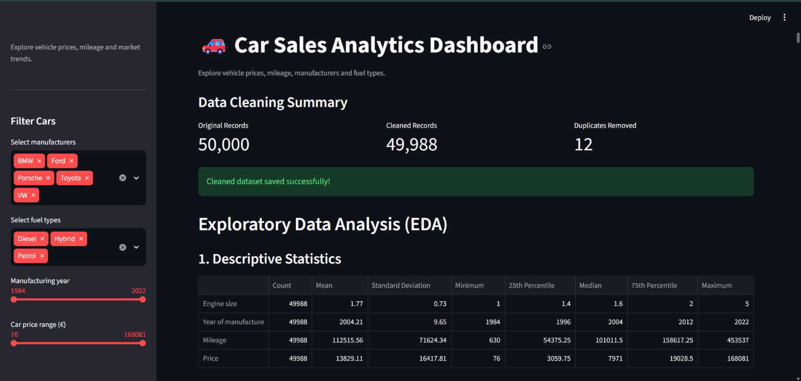
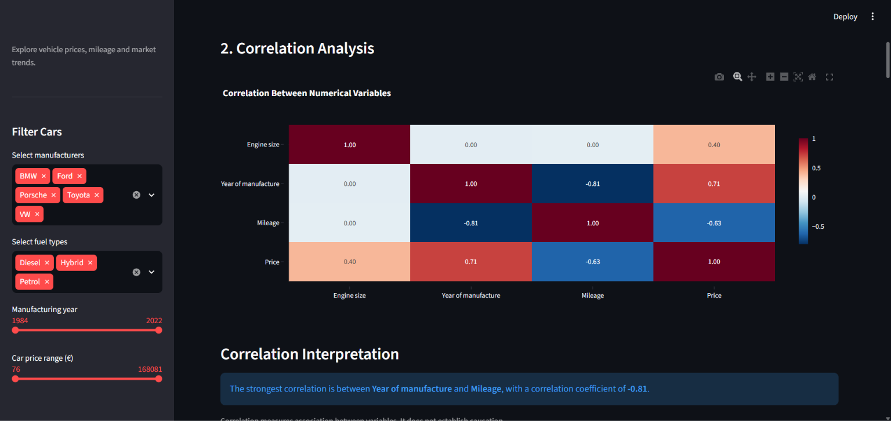
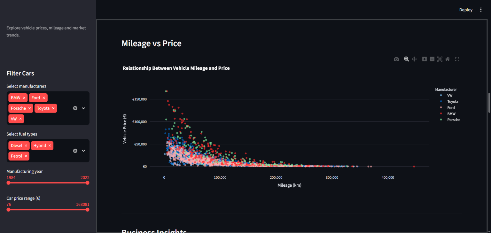

# 🚗 Car Sales Analytics Dashboard

### Turning Vehicle Data into Meaningful Business Insights

An interactive data analytics application built using Python, Pandas, NumPy, Plotly and Streamlit to explore vehicle pricing, mileage patterns, manufacturer comparisons and fuel-type trends.

🌐 **[Explore the Live Dashboard](https://car-sales-analytics-dashboard-at4kb5sfb7njcy5p3mybgt.streamlit.app/)**

💻 **[View Source Code on GitHub](https://github.com/Poojithasony/car-sales-analytics-dashboard)**

---

## About the Project

The automotive market generates large amounts of vehicle-related data, including manufacturing details, mileage, engine specifications, fuel categories and selling prices.

Understanding how these attributes relate to vehicle pricing can help businesses explore market segments, compare manufacturers and identify patterns in used-car listings.

This project transforms a dataset of 50,000 original vehicle records into an interactive analytical dashboard. It combines data preparation, statistical exploration and visual reporting to make vehicle-market patterns easier to investigate.

The application allows users to customise their analysis through filters and explore automatically generated business insights.

---

## Analytical Goals

The project was developed around the following analytical questions:

- How do average vehicle prices differ across manufacturers?
- What relationship exists between vehicle mileage and selling price?
- How do prices vary across different fuel categories?
- How does manufacturing year relate to vehicle pricing?
- Which manufacturers and fuel types represent the largest share of the dataset?
- What statistical relationships can be identified between numerical vehicle attributes?

The objective is to answer these questions through data exploration and interactive visualisation rather than relying on static reports.

---

## Dataset Overview

The project uses a structured CSV dataset containing 50,000 original vehicle records.

### Dataset Attributes

| Attribute           | Description                |
| ------------------- | -------------------------- |
| Manufacturer        | Vehicle manufacturer       |
| Model               | Vehicle model              |
| Engine size         | Engine capacity            |
| Fuel type           | Vehicle fuel category      |
| Year of manufacture | Vehicle manufacturing year |
| Mileage             | Distance travelled         |
| Price               | Vehicle selling price      |

### Data Preparation

The original dataset was inspected and processed using Pandas.

The cleaning workflow includes:

- Examining the original dataset structure.
- Identifying exact duplicate records.
- Removing duplicate entries.
- Comparing original and cleaned record counts.
- Exporting the cleaned dataset separately.

The initial cleaning removed 12 duplicate occurrences, resulting in 49,988 records.

---

## Analytical Methodology

The dashboard follows a sequence of analytical stages.

### 1. Data Inspection and Preparation

Pandas is used to load the dataset, inspect its structure and prepare numerical and categorical variables for analysis.

### 2. Exploratory Data Analysis

Descriptive statistics are calculated to understand the distribution and characteristics of numerical attributes.

The analysis includes:

- Record counts
- Mean and standard deviation
- Minimum and maximum values
- Median
- Quartiles and percentiles

### 3. Statistical Relationship Analysis

Correlation analysis is applied to examine associations between:

- Engine size
- Manufacturing year
- Mileage
- Price

A correlation matrix and heatmap provide a visual representation of the relationships between these variables.

The analysis focuses on linear associations and does not imply causation.

### 4. Interactive Visual Reporting

Plotly Express is used to create interactive charts, while Streamlit provides the application interface and filtering functionality.

### 5. Automated Business Interpretation

The application calculates selected business findings dynamically based on the user's filter selections.

---

##  Application Features

### A. Interactive Data Filtering

Users can customise their analysis through four dashboard filters:

- Manufacturer selection
- Fuel-type selection
- Manufacturing-year range
- Vehicle-price range

All analytical outputs respond to the selected filters.

### B. Key Performance Indicators

The dashboard provides a quick overview through four KPI metrics:

1. Matching vehicle records
2. Number of manufacturers
3. Average vehicle price
4. Average vehicle mileage

### C. Vehicle Market Analysis

The application includes seven analytical visualisations:

| Visualisation                       | Analytical Purpose                |
| ----------------------------------- | --------------------------------- |
| Average Price by Manufacturer       | Compare manufacturer pricing      |
| Vehicle Price Distribution          | Examine price distribution        |
| Mileage vs. Price                   | Explore mileage-price association |
| Manufacturer Distribution           | Compare vehicle representation    |
| Fuel Type Distribution              | Examine fuel-category composition |
| Average Price by Manufacturing Year | Explore yearly pricing trends     |
| Average Price by Fuel Type          | Compare fuel-category pricing     |

### D. Business Insight Generation

The application automatically identifies:

- Manufacturer with the highest average vehicle price.
- Manufacturer with the lowest average vehicle price.
- Fuel type with the highest average vehicle price.
- Most represented manufacturer.
- Average mileage of the selected vehicles.

These findings update according to the active filters.

### E. Data Quality Monitoring

A separate section evaluates the original and cleaned datasets.

The checks include:

- Original record count
- Missing cells
- Duplicate occurrences
- Missing vehicle prices
- Negative prices
- Negative mileage
- Cleaned record count
- Remaining duplicates

### F. Data Export

Users can download the currently filtered vehicle records as a CSV file for further analysis.

---

##  Dashboard Gallery

### 1. Dashboard Overview


### 2. Correlation Analysis


### 3. Vehicle Price Distribution


### 4. Mileage Analysis


### 5. Business Insights


### 6. Manufacturing Year Analysis

---

##  Statistical Approach and Project Scope

The current application focuses on descriptive and diagnostic analytics.

The statistical analysis includes descriptive summaries and Pearson correlation analysis.

No predictive machine-learning model has been implemented in the current version.

This distinction is important: the application explores historical data and relationships between variables rather than predicting future vehicle prices.

---

##  Development Environment and Technology Stack

| Category             | Technology                | Application                          |
| -------------------- | ------------------------- | ------------------------------------ |
| Programming          | Python                    | Application development              |
| Data Processing      | Pandas                    | Data cleaning and analysis           |
| Numerical Computing  | NumPy                     | Numerical operations                 |
| Visualisation        | Plotly Express            | Interactive charts                   |
| Dashboard Framework  | Streamlit                 | User interface                       |
| Statistical Analysis | Pandas                    | Descriptive and correlation analysis |
| Code Editor          | Visual Studio Code        | Development environment              |
| Version Control      | Git and GitHub            | Source-code management               |
| Deployment           | Streamlit Community Cloud | Online application hosting           |

---

##  Getting Started

The application can be executed locally by following these steps.

### Prerequisites

- Python installed
- Git installed
- Visual Studio Code (recommended)

### 1. Clone the Repository

```bash
git clone https://github.com/Poojithasony/car-sales-analytics-dashboard.git
```

### 2. Navigate to the Project Directory

```bash
cd car-sales-analytics-dashboard
```

### 3. Install Required Packages

```bash
python -m pip install -r requirements.txt
```

### 4. Launch the Application

```bash
python -m streamlit run app.py
```

### 5. Access the Dashboard

Open the local application address displayed in the terminal:

```text
http://localhost:8501
```

---

##  Repository Structure

```text
car-sales-analytics-dashboard/
│
├── app.py
├── README.md
├── requirements.txt
├── .gitignore
│
├── car_sales_data (1).csv
├── car_sales_cleaned.csv
│
└── Screenshots/
    ├── 01_dashboard_overview.png
    ├── 02_Correlation.png
    ├── 03_Vehicle price ditribution.png
    ├── 04_Mileage.png
    ├── 05_Business Insights.png
    └── 06_Average car price by manufacturing year.png
```

---

##  Future Development

The project can be extended with additional analytical capabilities:

- Develop a vehicle price estimation model using regression algorithms.
- Experiment with Random Forest and other machine-learning techniques.
- Introduce feature engineering using vehicle age, mileage and engine specifications.
- Explore price segmentation across vehicle categories.
- Add further business comparisons and analytical reporting.
- Improve dashboard performance and user experience.

These are proposed extensions and are not part of the current implementation.

---

##  Collaboration & Community Contributions


Suggestions and contributions to improve this project are welcome.

You can contribute by:
- Suggesting new features.
- Reporting bugs.
- Improving existing functionality.
- Enhancing visualisations.

To contribute, fork the repository and submit a pull request with your changes.

Thank you for your interest in the project!

---

## Author

**Poojitha Kore**

MSc Data Science, AI & Digital Business

Interested in Data Analytics, Business Intelligence, Python and AI-driven business applications.

🔗 **LinkedIn:** [Connect with Poojitha Kore](https://www.linkedin.com/in/poojitha-kore/)

💻 **GitHub:** [Poojithasony](https://github.com/Poojithasony)

📊 **Project Repository:** [Car Sales Analytics Dashboard](https://github.com/Poojithasony/car-sales-analytics-dashboard)

🌐 **Live Application:** [Explore the Dashboard](https://car-sales-analytics-dashboard-at4kb5sfb7njcy5p3mybgt.streamlit.app/)
